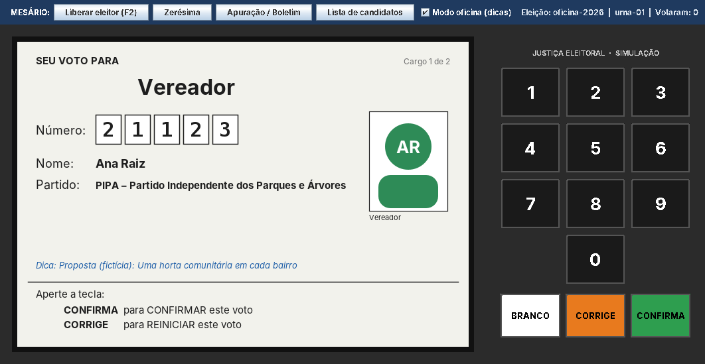
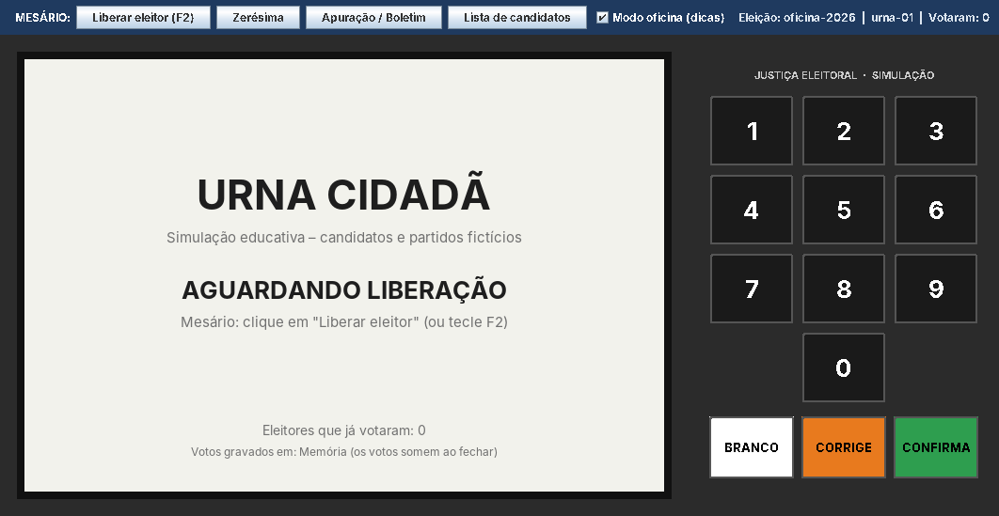
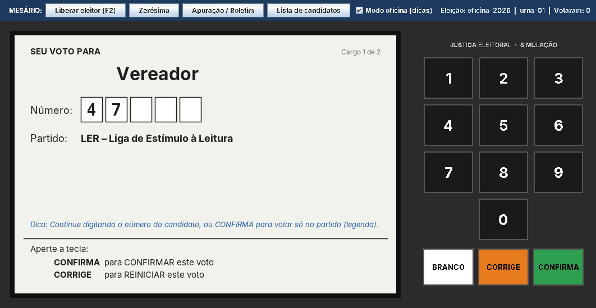
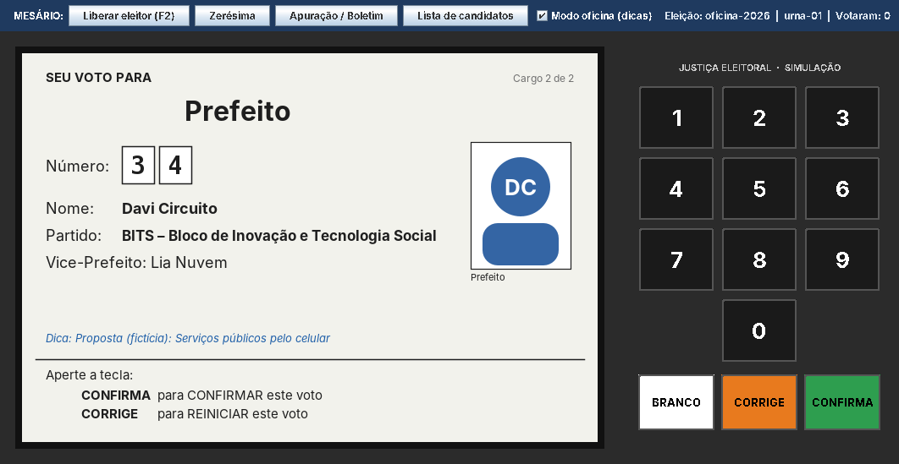
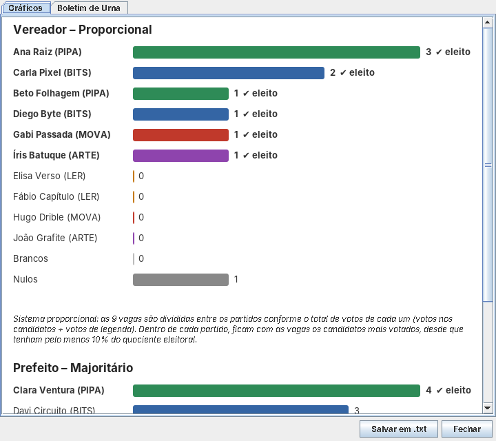

# Urna Cidadã – Simulador Educativo de Votação

Simulador de urna eletrônica em **Java Swing**, com persistência no **Firebase Cloud Firestore**.
Foi desenvolvido no projeto de extensão *"Urna Cidadã: simulação educativa do voto eletrônico e combate à
desinformação em ano eleitoral"*, na disciplina de Programação Orientada a Objetos da UNIJORGE (2026.2).

**Equipe:** Lucas de Castro P. Tourinho · Daniel Gomes Oitaven Garrido da Silva

> Todos os partidos, candidatos e propostas são **fictícios** e temáticos. O projeto é apartidário.



## Funcionalidades

- Votação sequencial para **Vereador** (proporcional, 5 dígitos) e **Prefeito** (majoritário, 2 dígitos, com vice)
- Voto nominal, **de legenda**, **em branco** e **nulo**, com as mesmas mensagens da urna real
- Teclas **BRANCO**, **CORRIGE** e **CONFIRMA**, bipes e tela de **FIM**
- **Mesário** (PIN): liberar eleitor, **Zerésima** e **Apuração / Boletim de Urna**
- Apuração com gráficos, quociente eleitoral e distribuição de vagas por partido
- **Modo oficina:** dicas educativas na tela a cada passo
- Persistência em **Firestore**, arquivo local ou memória, com **contingência offline**
- Sigilo: nenhum dado do eleitor é gravado

| | |
| --- | --- |
|  |  |
|  |  |

## Como executar

Requisito: **JDK 17 ou mais novo**. O programa não tem dependências externas.

```bash
# Linux / macOS
./executar.sh

# Windows
executar.bat

# ou com Maven
mvn package
java -jar target/urna-cidada.jar
```

Atalhos de teclado: números = teclas da urna · `Backspace` = CORRIGE · `B` = BRANCO · `Enter` = CONFIRMA · `F2` = liberar eleitor.
O PIN padrão do mesário é `1234`.

### Números para testar

| Cargo | Número | Candidato | Partido |
| --- | --- | --- | --- |
| Vereador | 21123 / 21456 | Ana Raiz / Beto Folhagem | PIPA (21) |
| Vereador | 34111 / 34222 | Carla Pixel / Diego Byte | BITS (34) |
| Vereador | 47777 / 47010 | Elisa Verso / Fábio Capítulo | LER (47) |
| Vereador | 58500 / 58123 | Gabi Passada / Hugo Drible | MOVA (58) |
| Vereador | 69100 / 69369 | Íris Batuque / João Grafite | ARTE (69) |
| Prefeito | 21, 34, 47, 58 | Clara Ventura, Davi Circuito, Helena Páginas, Rui Maratona | — |

Exemplos: `47` + CONFIRMA em Vereador = voto de legenda. `58999` = candidato inexistente (legenda MOVA). `99999` = nulo.

## Configurando o Firebase

1. Crie um projeto no [Console do Firebase](https://console.firebase.google.com/) e ative o **Cloud Firestore**.
2. Em *Firestore > Regras*, cole o conteúdo de [`firestore.rules`](firestore.rules) e publique.
3. Em *Configurações do projeto > Geral*, copie o **ID do projeto** e a **Chave de API da Web**.
4. Copie `config.exemplo.properties` para `config.properties` e preencha:

```properties
persistencia.modo=firestore
eleicao.id=oficina-escola-x
firebase.projectId=seu-projeto-id
firebase.apiKey=sua-web-api-key
```

Os votos aparecem em `eleicoes/{eleicao.id}/votos`. Para cada nova oficina, use um `eleicao.id` novo.
Se a internet cair, os votos vão para `~/.urna-cidada/contingencia-*.jsonl`. Depois, use **Enviar pendentes**.

> A integração usa a [API REST do Firestore](https://firebase.google.com/docs/firestore/use-rest-api)
> com `java.net.http`. Por isso o projeto não precisa de bibliotecas externas e roda em qualquer JDK.

## Testes

```bash
mvn test
```

São 30 testes JUnit, cobrindo o fluxo da urna, os tipos de voto, a apuração majoritária e proporcional, a conversão JSON/Firestore e a contingência offline.

## Entregas do projeto de extensão

- [Desafio 1 – Cronograma](entregas/Desafio1_Cronograma_UrnaCidada_Lucas_Daniel.pdf)
- [Desafio 2 – Memorial ODS](entregas/Desafio2_Memorial_ODS_UrnaCidada_Lucas_Daniel.pdf)
- [Desafio 3 – Relatório Final](entregas/Desafio3_Relatorio_Final_UrnaCidada_Lucas_Daniel.pdf)
- [Apresentação da oficina](entregas/Apresentacao_Oficina_UrnaCidada.pdf)

## Documentação

- [Especificação e modelagem](docs/modelagem.md): casos de uso, diagrama de classes, estados da urna e modelagem dos dados no Firestore

## Estrutura

```
src/main/java/br/unijorge/urnacidada
├── App.java          ponto de entrada
├── modelo/           Cargo, Candidato, Partido, Voto (e subclasses), Eleicao, RegistroVoto
├── servico/          Urna, Apuracao, RegraProporcional, RegraMajoritaria, DadosFicticios
├── repositorio/      VotoRepositorio, Firestore, Arquivo, Memória, Contingência
├── infra/            Json, FirestoreMapper, Configuracao
└── ui/               JanelaPrincipal, TelaUrna, TecladoUrna, DialogoResultados, Som
```

## Simplificações em relação à eleição real

- Turno único para prefeito (empate apenas sinalizado).
- No proporcional, aplica-se o quociente eleitoral, o quociente partidário, as sobras pelas maiores médias e a votação mínima de 10% do QE por candidato. Não se aplicam as exigências de 20% e 80% do QE nas sobras.
- Sem identificação biométrica do eleitor.

## Referências

- TSE – [Simulador de votação](https://www.tse.jus.br/hotsites/simulador-de-votacao/)
- [Documentação do Firebase](https://firebase.google.com/docs)
- [Java SE – Swing](https://docs.oracle.com/javase/)
