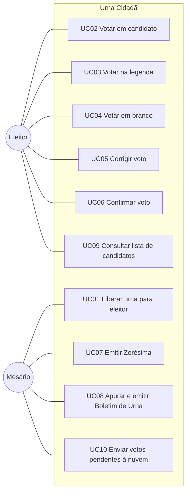
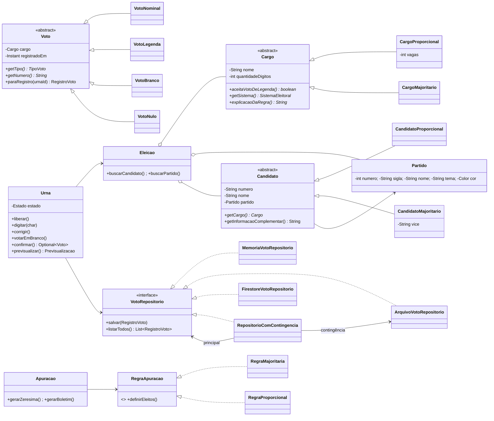
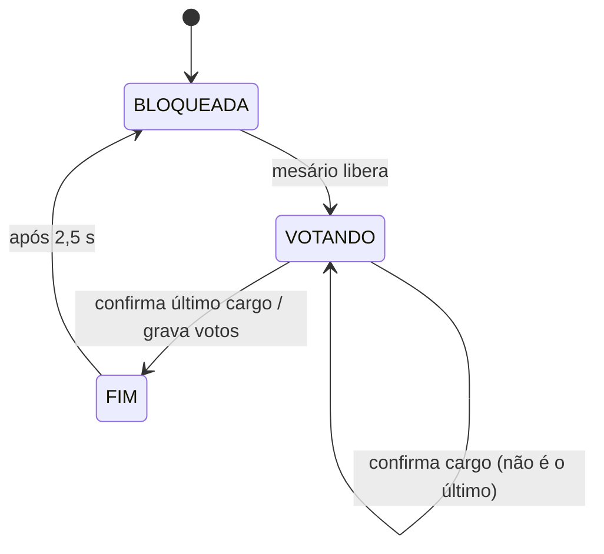

# Especificação e modelagem – Urna Cidadã

Este documento reúne a etapa 2 do projeto: casos de uso, modelagem das classes
orientadas a objetos e modelagem dos dados no Firebase (Cloud Firestore).

## 1. Escopo

- **Cargos:** Vereador (proporcional, 5 dígitos, 9 vagas) e Prefeito (majoritário, 2 dígitos, com vice).
- **Ordem de votação:** primeiro Vereador, depois Prefeito, como na urna real.
- **Tipos de voto:** nominal, de legenda (só Vereador), em branco e nulo.
- **Dados fictícios:** município de Nova Esperança, 5 partidos temáticos, 10 candidatos a vereador e 4 a prefeito.
- **Fora do escopo:** biometria, identificação do eleitor e 2º turno.

## 2. Atores e casos de uso

| Ator | Descrição |
| --- | --- |
| Eleitor | Estudante que vota na urna simulada |
| Mesário | Membro da equipe que libera a urna e emite os relatórios (protegido por PIN) |



### Descrição dos principais casos de uso

**UC02 – Votar em candidato**
1. A urna mostra "SEU VOTO PARA" e o cargo atual.
2. O eleitor digita os números do candidato.
3. A urna mostra nome, partido, retrato e (para prefeito) o vice.
4. O eleitor aperta CONFIRMA (UC06).
5. A urna passa para o próximo cargo. Depois do último, grava os votos e mostra **FIM**.

Fluxos alternativos:
- **A1 – Número de candidato inexistente, partido válido (Vereador):** a urna mostra "CANDIDATO INEXISTENTE / VOTO DE LEGENDA" e o voto vai para o partido.
- **A2 – Número inexistente:** a urna mostra "NÚMERO ERRADO / VOTO NULO".
- **A3 – Número incompleto:** CONFIRMA não tem efeito.

**UC03 – Votar na legenda:** em Vereador, o eleitor digita só os 2 números do partido e aperta CONFIRMA.

**UC04 – Votar em branco:** só funciona se nenhum número foi digitado. Depois disso, as teclas numéricas ficam bloqueadas até CORRIGE.

**UC07 – Emitir Zerésima:** o mesário informa o PIN. O sistema lista todos os candidatos com zero votos, provando que a urna começa vazia.

**UC08 – Apurar:** o mesário informa o PIN. O sistema lê todos os votos do banco, conta e mostra gráficos e o Boletim de Urna, com os eleitos de cada cargo.

## 3. Diagrama de classes



### Onde estão os pilares da POO

| Conceito | Onde aparece no código |
| --- | --- |
| **Encapsulamento** | Atributos `private` em todas as classes; a `Urna` só muda de estado pelos métodos `liberar`, `digitar`, `corrigir`, `votarEmBranco` e `confirmar`. `RegistroVoto` é um `record` imutável. |
| **Herança** | `CargoProporcional`/`CargoMajoritario` herdam de `Cargo`; `CandidatoProporcional`/`CandidatoMajoritario` de `Candidato`; os 4 tipos de voto de `Voto`. |
| **Polimorfismo** | `cargo.aceitaVotoDeLegenda()` muda o comportamento da urna sem `if` por tipo; `voto.getTipo()`/`getNumero()`; `candidato.getInformacaoComplementar()` mostra o vice só no majoritário; `RegraApuracao.para(cargo)` escolhe a regra de apuração. |
| **Abstração** | Classes abstratas `Cargo`, `Candidato`, `Voto`; interface `VotoRepositorio`, que permite trocar memória, arquivo ou Firestore sem mudar a `Urna`. |

Padrões de projeto usados: **Strategy** (`RegraApuracao`), **Decorator** (`RepositorioComContingencia`), **Repository** (`VotoRepositorio`).

### Organização em pacotes

```
br.unijorge.urnacidada
├── App.java                 ponto de entrada
├── modelo/                  entidades do domínio (Cargo, Candidato, Partido, Voto, Eleicao…)
├── servico/                 regras de negócio (Urna, Apuracao, regras de apuração, dados fictícios)
├── repositorio/             persistência (interface + memória, arquivo, Firestore, contingência)
├── infra/                   JSON, conversão Firestore e configuração
└── ui/                      interface gráfica Swing (janela, tela, teclado, gráficos)
```

## 4. Diagrama de estados da urna



## 5. Modelagem dos dados no Firebase (Cloud Firestore)

O Firestore é um banco NoSQL orientado a documentos. Os votos ficam em uma
subcoleção por eleição, para que cada oficina comece com a urna zerada sem
precisar apagar nada:

```
eleicoes (coleção)
└── {eleicaoId}            ex.: "oficina-escola-x-2026-11"
    └── votos (subcoleção)
        └── {id automático}
            ├── cargo:        "VEREADOR" | "PREFEITO"
            ├── tipo:         "NOMINAL" | "LEGENDA" | "BRANCO" | "NULO"
            ├── numero:       "21123"   (vazio para branco)
            ├── partido:      "PIPA"    (null para branco e nulo)
            ├── registradoEm: timestamp
            └── urnaId:       "urna-01"
```

Exemplo de documento:

```json
{
  "cargo": "VEREADOR",
  "tipo": "NOMINAL",
  "numero": "21123",
  "partido": "PIPA",
  "registradoEm": "2026-11-20T14:30:00Z",
  "urnaId": "urna-01"
}
```

Decisões de modelagem:

- **Um documento por voto, por cargo.** Equivale ao Registro Digital do Voto: não há ligação entre o voto de vereador e o de prefeito de um mesmo eleitor. Os votos de um eleitor são embaralhados antes de gravar.
- **Nenhum dado pessoal.** Não guardamos nome, idade ou foto dos estudantes, que em sua maioria são menores de idade (LGPD).
- **Candidatos e partidos ficam no código** (`DadosFicticios`), não no banco, porque são fixos e fictícios. O voto guarda número e sigla, que bastam para a apuração.
- **Imutabilidade.** As regras de segurança (`firestore.rules`) permitem criar e ler votos, mas proíbem alterar ou apagar.
- **Contingência.** Se a internet da escola cair, o voto vai para um arquivo local e é enviado depois pelo botão "Enviar pendentes".
